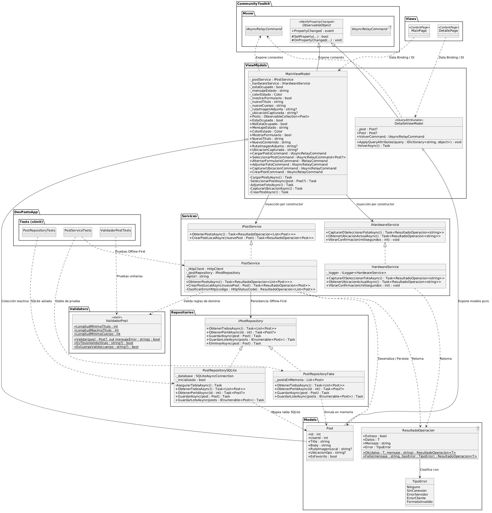
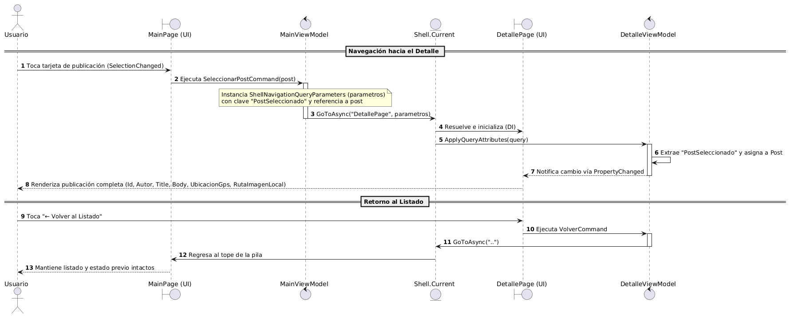

# ¿Cómo Funciona la Arquitectura de Nuestra App?

## 1. Justificación del Desacoplamiento Arquitectónico

En aplicaciones móviles basadas en frameworks modernos, la concentración de responsabilidades dentro del archivo de interfaz o su código subyacente (*code-behind*, `.xaml.cs`) conduce a antipatrones de diseño, comúnmente denominados *código espagueti*. Dicha práctica genera un alto acoplamiento entre la interfaz visual, las reglas de negocio, el acceso a sensores nativos y la persistencia de datos.

Para garantizar los atributos de calidad de software requeridos (mantenibilidad, escalabilidad, resiliencia sin conexión y testabilidad), el sistema adopta el principio de **Separación de Responsabilidades (SoC)** mediante la implementación estricta de:
- El patrón de presentación **MVVM (Model - View - ViewModel)**.
- La adopción de la biblioteca oficial **CommunityToolkit.Mvvm** para la eliminación de código repetitivo (*boilerplate*) mediante generadores de código en tiempo de compilación (*Source Generators*).
- El principio de **Inversión de Dependencias (DIP)** articulado a través del contenedor nativo de **Inyección de Dependencias (DI)** de .NET MAUI.
- Una arquitectura **Offline-First** respaldada por el patrón **Repositorio** sobre **SQLite** y validación de reglas de dominio aisladas.
- Una capa de abstracción de **Hardware y Sensores** (`IHardwareService`) que aísla las APIs nativas del dispositivo (`MediaPicker`, `Geolocation`, `Vibration`).

---

## 2. Implementación del Patrón MVVM y CommunityToolkit.Mvvm

El patrón MVVM estructura la presentación en tres componentes fundamentales con responsabilidades acotadas:

> `[ View (XAML) ] <--- Data Binding / Commands ---> [ ViewModel (ObservableObject) ] <--- Servicios / DI ---> [ Dominio + SQLite + Hardware ]`

### 2.1 Modelo y Validación de Dominio (`Model` & `Validators`)
Representa la estructura de las entidades de dominio, los metadatos locales y las reglas de integridad del sistema. Se mantiene completamente agnóstico a la tecnología visual y a la infraestructura de red.
- **Entidad (`Models/Post.cs`):** Encapsula las propiedades provenientes de la API externa (`Id`, `UserId`, `Title`, `Body`) junto con atributos de persistencia local (`[PrimaryKey]`, `[Table("Posts")]` de `sqlite-net-pcl`) y metadatos de hardware (`RutaImagenLocal`, `UbicacionGps`, `EsFavorito`).
- **Envoltura de Resultados (`Models/ResultadoOperacion.cs`):** Estandariza las respuestas de servicios y sensores mediante `Exitoso`, `Datos`, `Mensaje` y la enumeración `TipoError` (`Ninguno`, `SinConexion`, `ErrorServidor`, `ErrorCliente`, `FormatoInvalido`, `ErrorPersistencia`).
- **Validador de Dominio (`Validators/ValidadorPost.cs`):** Clase estática pura que centraliza las reglas de negocio (nulidad, `UserId` positivo, longitudes mínimas y máximas de título y cuerpo) antes de persistir datos localmente.

### 2.2 Vista (`View`)
Define la estructura visual y distribución de los elementos de la interfaz de usuario en lenguaje declarativo XAML.
- **Componentes:** `Views/MainPage.xaml` y `Views/DetallePage.xaml`.
- **Criterio de diseño:** Carece por completo de lógica algorítmica y de negocio en su *code-behind*. Su comportamiento está supeditado a los datos provistos por su contexto de enlace (`BindingContext`), resolviendo la interacción del usuario mediante comandos y mostrando tanto la lista sincronizada como el formulario de creación con vista previa de imagen y coordenadas GPS.

### 2.3 ViewModel (`ViewModel`)
Actúa como intermediario de presentación entre la Vista y los servicios de la aplicación.
- **Componentes:** `ViewModels/MainViewModel.cs` y `ViewModels/DetalleViewModel.cs` (ambos heredando de `ObservableObject`).
- **Responsabilidades y uso del Toolkit:**
  - **Notificación de Cambios y Source Generators:** Se utiliza la clase base `ObservableObject` y el atributo `[ObservableProperty]` sobre campos de respaldo privados (`_estaOcupado`, `_mensajeEstado`, `_colorEstado`, `_mostrarFormulario`, `_nuevoTitulo`, `_nuevoContenido`, `_rutaImagenAdjunta`, `_ubicacionCapturada`, `_post`). El compilador genera automáticamente en tiempo de compilación las propiedades públicas con notificación reactiva `PropertyChanged`.
  - **Comandos Declarativos:** Mediante `[RelayCommand]`, los métodos síncronos y asíncronos (`CargarPostsAsync`, `SeleccionarPostAsync`, `AlternarFormulario`, `AdjuntarFotoAsync`, `CapturarUbicacionAsync`, `CrearPostAsync`, `VolverAsync`) se exponen a la vista como comandos (`IRelayCommand` / `IAsyncRelayCommand`), gestionando la concurrencia y el estado de habilitación de controles.
  - **Orquestación:** Coordina la obtención/creación de publicaciones (`IPostService`) y la captura de sensores (`IHardwareService`), formateando el feedback visual y háptico para el usuario.

---

## 3. Capa de Servicios, Persistencia Offline-First y Hardware

Para evitar la duplicación de código y aislar las operaciones de entrada/salida (I/O) de red, almacenamiento local y sensores nativos, la interacción externa se encapsula en capas de servicio y repositorio desacopladas.

### 3.1 Contrato de Abstracción (`IPostService`)
Define el contrato funcional que requiere la aplicación:
```csharp
public interface IPostService
{
    Task<ResultadoOperacion<List<Post>>> ObtenerPostsAsync();
    Task<ResultadoOperacion<Post>> CrearPostLocalAsync(Post nuevoPost);
}
```
El uso de una interfaz permite desacoplar los consumidores (ViewModels) de la implementación tecnológica concreta, facilitando la futura sustitución del proveedor de datos o la incorporación de dobles de prueba (*mocks/fakes*) en entornos de testeo unitario.

### 3.2 Implementación y Estrategia Offline-First (`PostService`)
* Utiliza una instancia compartida de `HttpClient` inyectada como `Singleton` para evitar el agotamiento de sockets en el sistema operativo.
* Implementa una estrategia granular de manejo de excepciones asíncronas con bloques `catch` jerárquicos, diferenciando:
  * Errores de conectividad de bajo nivel y tiempo de espera (`HttpRequestException`, `TaskCanceledException`).
  * Respuestas erróneas del protocolo HTTP (`4xx` para errores de cliente, `5xx` para errores de servidor) mediante la envoltura `ResultadoOperacion<T>` y la enumeración `TipoError`.
* Deserializa la carga útil en formato JSON hacia colecciones de objetos C# mediante `System.Text.Json` con opciones de insensibilidad a mayúsculas/minúsculas.
* **Sincronización y Respaldo Local (*Offline-First*):** Cuando la consulta a JSONPlaceholder es exitosa, persiste el lote actualizado en SQLite mediante `IPostRepository.GuardarLoteAsync(...)` sin sobrescribir publicaciones creadas localmente. Ante errores de red (`SinConexion`) o fallos del servidor (`ErrorServidor`), recupera automáticamente los registros cacheados en la base local para garantizar continuidad operativa sin conexión.
* **Creación Local Validada:** En `CrearPostLocalAsync`, ejecuta `ValidadorPost.Validar(...)` antes de persistir en SQLite, rechazando entidades inconsistentes con `TipoError.ErrorCliente`.

### 3.3 Patrón Repositorio y Persistencia Local (`IPostRepository`)
Define el contrato de acceso a datos locales (`ObtenerTodosAsync`, `ObtenerPorIdAsync`, `GuardarAsync`, `GuardarLoteAsync`), desacoplando la lógica de negocio del motor de base de datos:
* **`PostRepositorySQLite`:** Implementación productiva sobre `SQLiteAsyncConnection` (`sqlite-net-pcl`) almacenada en `FileSystem.AppDataDirectory/devposts.db3`, con inicialización diferida e idempotente de tablas y operaciones `InsertOrReplaceAsync`.
* **`PostRepositoryFake`:** Implementación en memoria utilizada para pruebas automatizadas deterministas sin acceso a disco.

### 3.4 Abstracción de Hardware y Sensores (`IHardwareService`)
```csharp
public interface IHardwareService
{
    Task<ResultadoOperacion<string>> CapturarOSeleccionarFotoAsync();
    Task<ResultadoOperacion<string>> ObtenerUbicacionActualAsync();
    void VibrarConfirmacion(int milisegundos = 250);
}
```
* Encapsula las APIs nativas de `Microsoft.Maui.Essentials` (`MediaPicker`, `Geolocation`, `Vibration`) detrás de una interfaz inyectable (`HardwareService`).
* Gestiona permisos en tiempo de ejecución (`Permissions.Camera`, `Permissions.LocationWhenInUse`), almacena de forma segura las fotografías capturadas o seleccionadas dentro de `FileSystem.AppDataDirectory` y registra trazas diagnósticas con `ILogger<HardwareService>` sin interrumpir la experiencia si el dispositivo o emulador carece de algún sensor.

---

## 4. Inversión de Control e Inyección de Dependencias (DI)

La solución elimina la instanciación directa (`new`) de dependencias de infraestructura dentro de las clases de presentación. El ensamblaje de la aplicación se centraliza en `MauiProgram.cs` mediante el contenedor integrado de .NET MAUI.

### Política de Ciclos de Vida
- **`Singleton`:** Aplicado a componentes de infraestructura y estado compartido durante todo el ciclo de vida de la app: `HttpClient`, `IPostRepository` (`PostRepositorySQLite` con ruta en `AppDataDirectory`), `IPostService` (`PostService`) e `IHardwareService` (`HardwareService`).
- **`Transient`:** Aplicado a los ViewModels (`MainViewModel`, `DetalleViewModel`) y las Páginas (`MainPage`, `DetallePage`). Se garantiza una instancia limpia e independiente en cada solicitud de navegación, evitando que el estado de una sesión previa persista de forma indebida.


---

## 5. Mecanismo de Navegación y Paso de Parámetros Complejos

La navegación entre la vista de listado y la vista de detalle se gestiona mediante el sistema declarativo basado en URI de **.NET MAUI Shell**.

Para resolver la transferencia de datos entre pantallas:
1. **Evitación de parámetros planos por URI:** Se desestima la descomposición de la entidad en cadenas primitivas individuales (`?id=1&title=texto`) debido a riesgos de truncamient, incompatibilidad de codificación de caracteres o sobrecosto de re-consulta innecesaria.
2. **Transferencia por `ShellNavigationQueryParameters`:** Al invocarse `Shell.Current.GoToAsync("DetallePage", parametros)`, se encapsula el objeto completo `Post` (incluyendo su imagen local y ubicación GPS) dentro de un diccionario transitorio que se libera automáticamente tras completar la navegación.
3. **Consumo vía `IQueryAttributable`:** `DetalleViewModel` implementa el método `ApplyQueryAttributes(IDictionary<string, object> query)`, recuperando la referencia directa al objeto tipado y notificando a `DetallePage`.

---

## 6. Estrategia de Testing Automatizado (`DevPostsApp.Tests`)

La solución incorpora un proyecto dedicado de pruebas automatizadas (`DevPostsApp.Tests`) construido con **xUnit** sobre `.NET 10`, estructurado bajo el patrón **AAA (Arrange - Act - Assert)**:
- **Pruebas Unitarias de Dominio (`ValidadorPostTests`):** Verifican mediante `[Fact]` y `[Theory]` / `[InlineData]` las reglas de validación de `Post` y casos borde.
- **Pruebas de Integración de Repositorio (`PostRepositoryTests`):** Validan la persistencia real en bases SQLite temporales aisladas, comprobando el almacenamiento de metadatos de hardware (`RutaImagenLocal`, `UbicacionGps`) y operaciones en lote sin duplicados.
- **Pruebas de Integración de Servicios (`PostServiceTests`):** Simulan respuestas de red mediante un `HttpMessageHandler` personalizado y `PostRepositoryFake`, verificando la sincronización online, la recuperación automática en modo offline y el rechazo de datos inválidos.

---

## 7. Referencias a Diagramas de Arquitectura

Para un análisis esquemático del sistema, consultar los diagramas modelados en PlantUML en este mismo directorio:
* **Estructura y Relación de Capas:** [`arquitectura.puml`](./arquitectura.puml)  
  

* **Secuencia de Navegación y Parámetros:** [`navegacion_secuencia.puml`](./navegacion_secuencia.puml)  
  

* **Instrucciones de compilación y visualización:** [`plantUML.md`](./plantUML.md)
